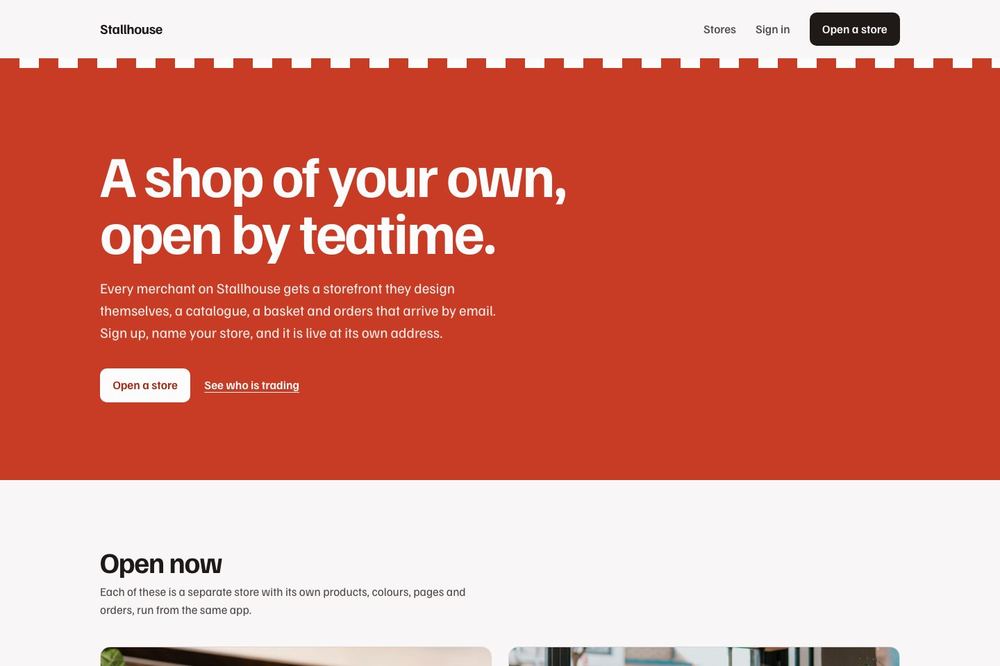
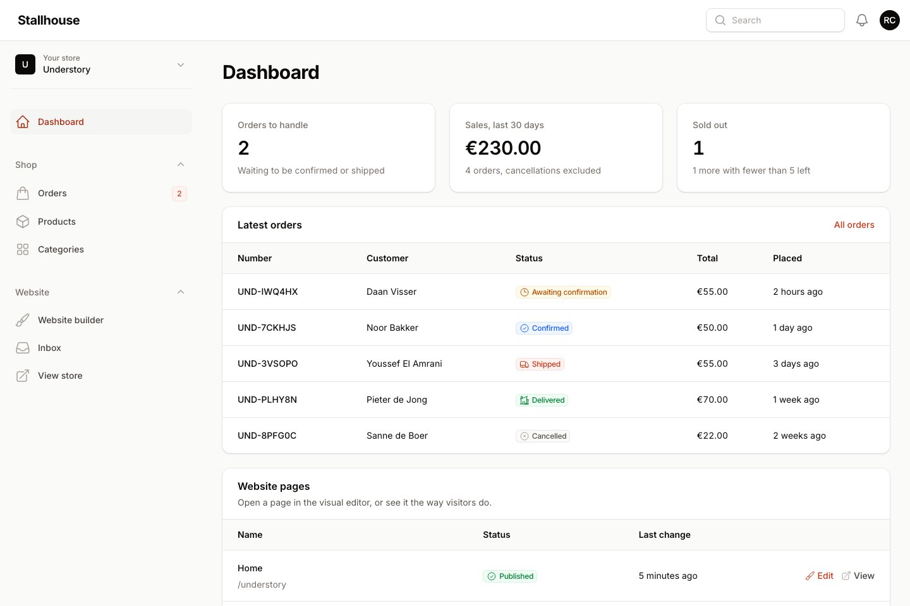
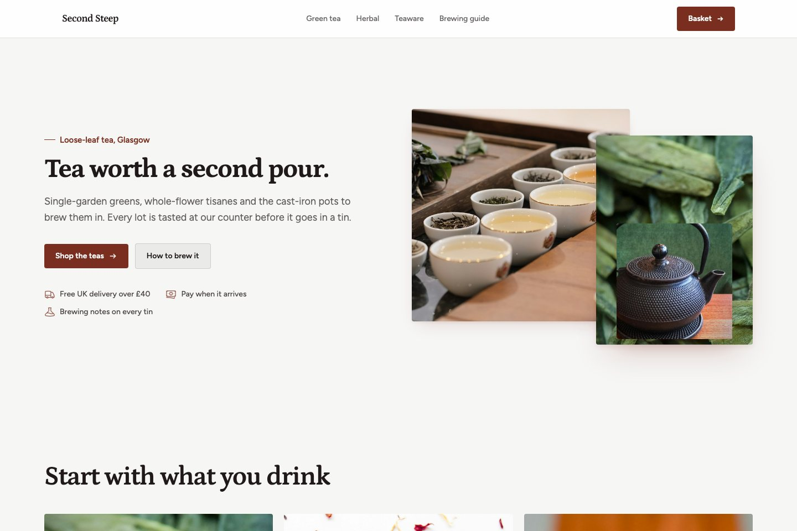

# FilamentCraft multi-store starter

A Laravel platform where anyone can sign up and open a store. Each store gets its own
storefront, catalog, basket, checkout and orders, all running in one app.



The platform is Stallhouse, and it comes with two stores already trading:

- **Second Steep**, a tea shop in Glasgow, priced in pounds.
- **Understory**, a plant shop in Amsterdam, priced in euros.

They share nothing but the code. Different products, colors, fonts, pages, delivery rates and
order numbers. Sign up and a third store is built for you in a second.

Built on Laravel 13, Filament 5 and [FilamentCraft](https://filamentcraft.dev).

## Before you start

- PHP 8.3 or newer and Composer 2. No Node, no build step.
- A FilamentCraft license. The package is installed from a private Composer registry, and
  setup asks for the email you bought it with and your license key.
  [Get a license](https://filamentcraft.dev/pricing).

## Install

```bash
git clone https://github.com/filamentcraft/starter-multistore my-platform
cd my-platform
composer setup
```

`composer setup` checks your license against `packages.filamentcraft.dev`, installs the
dependencies, creates a SQLite database, opens the two sample stores and prints their
addresses. It is safe to run again.

Then start the server:

```bash
composer dev
```

| Address | What it is |
|---|---|
| http://localhost:8000 | The platform page, listing every live store |
| http://localhost:8000/second-steep | The tea shop |
| http://localhost:8000/understory | The plant shop |
| http://localhost:8000/app | The merchant panel |

Sign in to the panel as `admin@example.com` with the password `password`. That account runs
both sample stores; switch between them from the menu at the top of the sidebar.

<details>
<summary>Installing without a prompt (CI, Docker, servers)</summary>

Setup reads the credentials from any of these, in order, and never asks:

1. `COMPOSER_AUTH` with an `http-basic` entry for `packages.filamentcraft.dev`
2. an `auth.json` next to `composer.json`
3. your global Composer credentials
   (`composer config --global http-basic.packages.filamentcraft.dev you@example.com KEY`)
4. `FILAMENTCRAFT_EMAIL` and `FILAMENTCRAFT_KEY`

</details>

## Opening a store

Anyone can register at `/app/register`. After creating an account they are asked to open a
store: a name, the address it will live at, a contact email and a currency. The store is
live the moment they submit, with a home page, shop, product page, basket, checkout and a
delivery page, ready for products.



Inside the panel each merchant only ever sees their own store:

- **Orders** from their checkout, with confirm, ship, deliver and cancel. Cancelling puts the
  stock back.
- **Products** and **Categories**, priced in the store's currency.
- **Website builder**, the FilamentCraft editor, for every page, color and font of the
  storefront.
- **Store settings** in the store menu, for the name and contact email.

A new order emails the customer, with replies going to the store's contact address, and
notifies everyone who runs that store in the panel.



## How it fits together

| Path | What it is |
|---|---|
| `app/Models/Store.php` | The tenant. Owns a FilamentCraft site, products, categories and orders |
| `app/Actions/OpenStore.php` | Creates a store, adds its owner and builds its storefront |
| `app/Storefront/CurrentStore.php` | Works out which store a request is for |
| `app/Storefront/CatalogStorefront.php` | What the storefront sections read products from and send orders to |
| `app/Blueprints` | Storefronts: the shared shop pages, the starter every new store gets, and the two sample stores |
| `app/Filament` | The merchant panel: registration, store settings, resources, widgets |
| `resources/views/platform.blade.php` | The platform page at `/` |
| `database/seeders/Stores` | The two sample stores and their catalogs |
| `routes/web.php` | `/` for the platform, then `/{store}/...` for every storefront |

Stores live at the root of the URL, next to the app's own routes. The slugs the app needs are
in `Store::RESERVED_SLUGS`, which both the route and the registration form respect. Add to it
when you add a top-level route.

## Making it yours

- **The platform.** Rename Stallhouse in `resources/views/platform.blade.php` and in the panel
  provider, `app/Providers/Filament/MerchantPanelProvider.php`.
- **What new stores start with.** `StarterStoreSite` is the storefront a merchant gets on
  sign-up. Change its pages, colors and fonts, or add more `StoreBlueprint` classes and let
  merchants pick one in `StoreForm`.
- **Currencies.** Add a case to `App\Enums\Currency`.
- **Payment.** Checkout is cash on delivery. To take cards, create the order in
  `CatalogStorefront::placeOrder()` as pending and hand the customer to your payment provider
  before confirming it.

`php artisan migrate:fresh --seed` rebuilds everything from code, wiping any stores created
since.

## Going live

- Set `APP_URL` to the real domain.
- Give the server your registry credentials through `COMPOSER_AUTH`, or on Laravel Forge under
  **Site → Settings → Composer**.
- Add `php artisan filamentcraft:upgrade` to your deploy script after `migrate`.
- Configure a real mailer so order confirmations reach customers.
- Raise PHP's `upload_max_filesize` and `post_max_size` if merchants upload photos straight
  from a phone.
- `php artisan filamentcraft:doctor` checks the install and tells you how to fix what it finds.

## Tests

```bash
composer test
```

Runs Pint, PHPStan at level 6 and the Pest suite. The tests open a store through the
registration page, check that stores never see each other's products, baskets or orders, and
take an order through checkout. The GitHub workflow does the same; add `FILAMENTCRAFT_EMAIL`
and `FILAMENTCRAFT_KEY` as repository secrets so it can install the package.

## The other starter kits

- [starter-site](https://github.com/filamentcraft/starter-site): a company website with a
  contact form.
- [starter-store](https://github.com/filamentcraft/starter-store): a single shop with a
  catalog, basket, checkout and orders.

## License

The code in this repository is MIT licensed. FilamentCraft itself is commercial software.
Photographs are from Unsplash; see [CREDITS.md](CREDITS.md).
